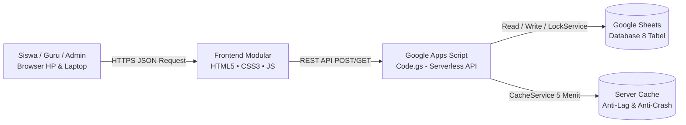
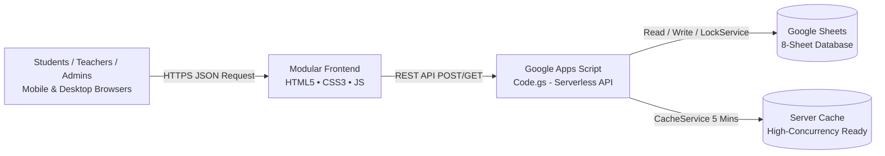

<div align="center">

# 🎓 Portal Hasil Penilaian (PHP)
### Sistem Transparansi Nilai Akademik & Manajemen Penilaian Sekolah Berbasis Web Serverless

[](#-4-kenapa-proyek-ini-open-source)
[](#-1-kenapa-proyek-ini-dibuat)
[](#-2-deskripsi-sistem)
[](#-4-kenapa-proyek-ini-open-source)

<br/>

**🌐 Pilih Bahasa / Select Language:**

[**🇮🇩 Bahasa Indonesia (Bahasa Utama)**](#-bahasa-indonesia) &nbsp;&nbsp;|&nbsp;&nbsp; [**🇬🇧 English Version (Secondary Language)**](#-english-version)

</div>

---

<a id="-bahasa-indonesia"></a>
# 🇮🇩 Bahasa Indonesia

> **Navigasi Cepat:**
> [1. Kenapa Ini Dibuat?](#-1-kenapa-proyek-ini-dibuat) •
> [2. Deskripsi Sistem](#-2-deskripsi-sistem) •
> [3. Cara Install, Pasang & Penggunaan](#-3-cara-install-pasang--penggunaan) •
> [4. Kenapa Open-Source?](#-4-kenapa-proyek-ini-open-source) •
> [5. Donasi & Dukungan](#-5-dukung-proyek-ini-tetap-gratis-donasi)

---

## 💡 1. Kenapa Proyek Ini Dibuat?

Dalam kegiatan evaluasi belajar di sekolah (baik Penilaian Harian, Proyek/Presentasi, Penilaian Tengah Semester, Penilaian Akhir Semester, maupun Tes Kemampuan Akademik/TKA), sering muncul berbagai kendala klasik yang membebani guru maupun siswa:

<table>
  <tr>
    <th width="50%">❌ Masalah di Lapangan</th>
    <th width="50%">✅ Solusi yang Dihadirkan Sistem Ini</th>
  </tr>
  <tr>
    <td><strong>Antrean & Kebingungan Siswa:</strong> Siswa sering menumpuk di ruang guru hanya untuk menanyakan nilai atau apakah mereka harus mengikuti remedial.</td>
    <td><strong>Akses Mandiri 24/7:</strong> Siswa cukup mengetik NIS atau Nama Lengkap secara utuh untuk melihat rincian nilai, status ketuntasan, dan instruksi remedial.</td>
  </tr>
  <tr>
    <td><strong>Privasi Nilai Kurang Terjaga:</strong> Daftar nilai yang ditempel di mading atau dibagikan lewat PDF grup kelas membuat nilai siswa bisa dilihat oleh teman lainnya.</td>
    <td><strong>Pencarian Ketat & Privat:</strong> Sistem mewajibkan kecocokan penuh (<em>exact match</em>) NIS atau Nama Lengkap sehingga nilai setiap siswa tetap bersifat pribadi.</td>
  </tr>
  <tr>
    <td><strong>Komunikasi Remedial Tidak Terarah:</strong> Siswa sering menghubungi guru lewat WhatsApp tanpa menyebutkan nama, kelas, maupun mata pelajaran dengan sopan.</td>
    <td><strong>Template WhatsApp Otomatis:</strong> Jika status siswa <em>Remedial</em>, sistem otomatis menyiapkan format pesan WhatsApp sopan yang terisi nama, kelas, dan mapel siswa.</td>
  </tr>
  <tr>
    <td><strong>Beban Administrasi Guru & Biaya Server:</strong> Aplikasi rapor/nilai komersial membutuhkan biaya sewa VPS/hosting bulanan yang memberatkan kas sekolah.</td>
    <td><strong>100% Gratis Tanpa Biaya Server:</strong> Menggunakan <strong>Google Sheets & Google Apps Script</strong> sebagai database dan backend <em>serverless</em> gratis selamanya.</td>
  </tr>
</table>

---

## 📖 2. Deskripsi Sistem

**Portal Hasil Penilaian** adalah aplikasi web modern yang dirancang dengan arsitektur **Modular Frontend (HTML5, CSS3, Vanilla JavaScript)** dan **Serverless Backend (Google Apps Script + Google Sheets)**. Sistem ini memisahkan hak akses menjadi **3 peran utama**:

### 🎯 Fitur Utama Berdasarkan Peran

<details open>
<summary><strong>👨‍🎓 A. Portal Siswa & Publik (Tanpa Login)</strong></summary>

- **Pencarian Nilai Privat:** Pencarian nilai berdasarkan **NIS** atau **Nama Lengkap** secara utuh, dilanjutkan dengan pemilihan **Mata Pelajaran / Jenis Ujian**.
- **4 Variasi Bentuk Kartu Nilai Dinamis:** Tampilan kartu hasil otomatis menyesuaikan jenis ujian yang diatur admin:
  1. *Default:* Menampilkan Nilai 1 (Slide 1), Nilai 2 (Slide 2), Nilai 3 (Presentasi), Nilai Tambah, dan Nilai Akhir.
  2. *Nilai Akhir Saja:* Tampilan kartu ringkas yang menonjolkan skor akhir dan ketuntasan KKM.
  3. *Khusus TKA (Tes Kemampuan Akademik):* Menampilkan rincian skor literasi/Bahasa Indonesia, numerasi/Matematika, dan penalaran.
  4. *Input Sendiri (Kustom):* Label komponen penilaian dapat disesuaikan secara bebas oleh admin.
- **Notifikasi Suara & Cetak Kartu:** Efek audio halus saat kartu nilai terbuka (nada apresiasi untuk status **AMAN / TUNTAS** dan nada pengingat untuk **REMEDIAL**), dilengkapi tombol **Cetak Kartu Nilai**.
- **Instruksi & Template WhatsApp Remedial:** Tombol salin sekali klik (*1-Click Copy*) untuk menyalin pesan permohonan perbaikan nilai yang sudah terisi identitas siswa.
- **Papan Peringkat Apresiasi (Auto-Rotate 30 Detik):** Menampilkan peringkat terbaik untuk **6 kategori** (Pembuatan Slide, Presentasi, dan Nilai Total — baik per Kelompok maupun per Individu) dengan filter Kelas dan Mata Pelajaran.
- **Tema Terang / Gelap Otomatis:** Menyesuaikan tampilan siang (*Light Mode*) dan malam (*Dark Mode*) secara otomatis berdasarkan jam lokal perangkat.

</details>

<details>
<summary><strong>👩‍🏫 B. Panel Guru Mata Pelajaran (Admin Lainnya)</strong></summary>

- **Isolasi Kelas Ampuan:** Saat pertama kali masuk, guru memilih kelas yang diampu. Guru hanya dapat melihat dan mengelola nilai siswa pada kelas tersebut.
- **Kunci Mata Pelajaran Otomatis:** Mata pelajaran pada formulir input nilai otomatis terkunci sesuai data akun guru sehingga tidak terjadi salah input lintas mapel.
- **Rumus Penilaian & Redistribusi Poin Otomatis:** Nilai akhir dihitung otomatis dari rata-rata komponen ditambah *Nilai Tambah* (maksimal 100). Jika total melebihi 100, sisa poin otomatis didistribusikan ke komponen nilai lainnya.
- **Integrasi Microsoft Excel (SheetJS):** Unduh template Excel sesuai kelas ampuan, isi atau edit secara offline di Excel, lalu unggah kembali untuk memperbarui nilai secara massal.
- **Surat Permohonan Koreksi Data Siswa:** Fitur untuk memilih siswa yang salah penulisan NIS/Nama dan mengirimkan surat koreksi digital (atau cetak PDF) langsung ke Admin Pertama.

</details>

<details>
<summary><strong>🛡️ C. Panel Admin Utama (Super Admin) & Keamanan Berlapis</strong></summary>

- **Manajemen Master Data Lengkap:** Mengelola **Master Guru Mapel**, **Master Mata Pelajaran / Ujian Lain**, **Master Kelas**, **Master Siswa**, dan **Master Akun**.
- **Dashboard Statistik & Grafik Batang (Chart.js):** Visualisasi perbandingan jumlah siswa **Aman (≥ KKM)** vs **Remedial (< KKM)** per kelas secara *real-time*.
- **Keamanan Data & Sesi:**
  - Password di-hash menggunakan **SHA-256 + Salt** di server; password asli maupun hash tidak pernah dikirim ke antarmuka browser.
  - Sistem peringatan ketidakaktifan bertingkat (**Peringatan 1/3, 2/3, 3/3**) dengan alarm audio sebelum sesi otomatis keluar (*auto-logout*).
  - Kartu konfirmasi pengaman sebelum menambah, mengubah, atau menghapus data, serta **Log Audit Keamanan** untuk merekam seluruh aktivitas penting.

</details>

### 🏗️ Arsitektur Sistem



---

## 🚀 3. Cara Install, Pasang & Penggunaan

Ikuti langkah-langkah berurutan di bawah ini untuk memasang sistem hingga siap digunakan oleh seluruh warga sekolah.

### 📋 Daftar Periksa Persiapan (Checklist)

- [ ] Memiliki akun **Google** (Gmail / Google Workspace) untuk Google Sheets & Apps Script.
- [ ] Memiliki folder kode proyek (`index.html`, folder `css/`, folder `js/`, dan `backend/Code.gs`).
- [ ] Memiliki akun **GitHub / Netlify / Vercel** (opsional, untuk mempublikasikan website secara gratis ke internet).

---

### Tahap 1: Memasang Backend & Database (Google Sheets + Apps Script)

1. Buka [Google Drive](https://drive.google.com) dan buat sebuah **Google Spreadsheet** baru, beri nama misalnya: `Database_Portal_Penilaian`.
2. Pada menu bagian atas Spreadsheet, klik **Ekstensi (Extensions)** ➔ **Apps Script**.
3. Hapus seluruh kode bawaan pada file `Code.gs`, lalu salin dan tempel seluruh kode dari file **`backend/Code.gs`**.
4. Klik ikon **Simpan (Save)** atau tekan <kbd>Ctrl</kbd> + <kbd>S</kbd>.
5. Pada bilah alat (*toolbar*) bagian atas editor Apps Script, pilih fungsi **`setupDatabase`** di samping tombol *Run*, lalu klik **Jalankan (Run)**.
   - *Catatan:* Saat pertama kali dijalankan, klik **Review Permissions** ➔ pilih akun Google Anda ➔ klik **Advanced** ➔ klik **Go to ... (unsafe)** ➔ klik **Allow**.
   - Fungsi ini otomatis membuat 8 *sheet* (`Akun`, `GuruMapel`, `Mapel`, `Kelas`, `Siswa`, `Nilai`, `Surat`, `AuditLog`) beserta akun bawaan **Super Admin**.
6. Publikasikan Apps Script menjadi Web API:
   - Klik tombol biru **Deploy** (kanan atas) ➔ **New deployment**.
   - Klik ikon gerigi di samping *Select type* ➔ pilih **Web app**.
   - Isi *Description*: `API Portal Penilaian v1`.
   - **Execute as:** pilih `Me (email Anda)`.
   - **Who has access:** pilih `Anyone` (wajib agar siswa & guru dapat mengakses dari browser tanpa error CORS/login Google).
   - Klik **Deploy**, lalu **salin URL Web App** yang muncul (berakhiran `/exec`).

---

### Tahap 2: Menghubungkan Frontend ke Backend

1. Buka file **`js/config.js`** menggunakan editor teks (VS Code, Notepad++, dll).
2. Tempelkan URL Web App yang Anda salin pada Tahap 1 ke variabel `API_URL`:

```javascript
const APP_CONFIG = {
  API_URL: '[https://script.google.com/macros/s/PASTE_ID_DEPLOYMENT_ANDA_DI_SINI/exec](https://script.google.com/macros/s/PASTE_ID_DEPLOYMENT_ANDA_DI_SINI/exec)',
  KKM: 75,
  LEADERBOARD_INTERVAL_MS: 30000, // Rotasi papan peringkat setiap 30 detik
  IDLE_STEP_1_MS: 180000,         // Peringatan 1 setelah 3 menit diam
  IDLE_STEP_2_MS: 240000,         // Peringatan 2 setelah 4 menit diam
  IDLE_LOGOUT_MS: 300000          // Otomatis keluar setelah 5 menit diam
};
```

3. Simpan file **`js/config.js`**.

---

### Tahap 3: Cara Menjalankan & Mempublikasikan Website

<details>
<summary><strong>🌐 Opsi A: Publikasi Online Gratis via GitHub Pages (Direkomendasikan)</strong></summary>

1. Buat repositori baru di [GitHub](https://github.com) dengan nama misalnya `portal-hasil-penilaian`.
2. Unggah seluruh file (`index.html`, folder `css/`, folder `js/`, dan `README.md`) ke repositori tersebut.
3. Masuk ke menu **Settings** ➔ **Pages** pada repositori GitHub Anda.
4. Pada bagian **Build and deployment** ➔ *Source*, pilih **Deploy from a branch**, pilih branch `main` dan folder `/ (root)`, lalu klik **Save**.
5. Tunggu 1–2 menit, tautan website sekolah Anda akan aktif (contoh: `https://username.github.io/portal-hasil-penilaian/`).

</details>

<details>
<summary><strong>💻 Opsi B: Menjalankan Secara Lokal di Komputer / Laptop</strong></summary>

1. Buka folder proyek menggunakan **Visual Studio Code**.
2. Pasang ekstensi **Live Server** (atau jalankan perintah `npx serve .` di terminal).
3. Klik kanan pada **`index.html`** ➔ pilih **Open with Live Server**.
4. Aplikasi siap diakses melalui `http://127.0.0.1:5500`.

</details>

---

### Tahap 4: Panduan Penggunaan Aplikasi

1. **Login Pertama Admin Utama (Super Admin):**
   - Klik tombol **Login Admin** di pojok kanan atas.
   - Gunakan kredensial bawaan:
     - **Username:** `admin`
     - **Password:** `admin123`
   - *Segera ubah password bawaan ini melalui menu **Master Akun** demi keamanan.*
2. **Urutan Pengisian Data oleh Admin Utama:**
   - **Master Guru Mapel:** Tambahkan daftar nama guru mata pelajaran.
   - **Master Mapel / Ujian:** Tambahkan mata pelajaran/ujian, pilih guru pengampu, KKM, serta pilih **Bentuk Card Hasil** (*Default*, *Nilai Akhir*, *TKA*, atau *Kustom*).
   - **Master Kelas:** Tambahkan daftar kelas (misal `VII-A`, `VIII-B`, `XI-1`).
   - **Master Siswa:** Masukkan data `NIS`, `Nama Lengkap`, `Kelas`, dan `Kelompok` (opsional).
   - **Master Akun:** Buatkan akun untuk masing-masing Guru Mata Pelajaran beserta mata pelajaran yang diampu.
3. **Input Nilai oleh Guru Mata Pelajaran:**
   - Guru login menggunakan akun masing-masing ➔ centang kelas yang diampu pada pop-up awal.
   - Nilai dapat diinput satu per satu melalui tombol **+ Input Nilai** (pencarian nama/NIS siswa otomatis), atau melalui **Download Template Excel** ➔ isi/edit di Excel ➔ **Upload Excel Nilai**.
4. **Pengecekan Nilai oleh Siswa:**
   - Siswa membuka halaman utama ➔ mengetik **NIS** atau **Nama Lengkap** secara utuh ➔ klik **Cari Nilai** ➔ memilih mata pelajaran ➔ melihat status **AMAN** atau menyalin template WhatsApp jika **REMEDIAL**.

---

## 🌍 4. Kenapa Proyek Ini Open-Source?

Proyek **Portal Hasil Penilaian** dirilis secara **Open-Source** di bawah **Lisensi MIT** karena keyakinan bahwa teknologi pendidikan yang mendasar harus dapat diakses oleh setiap sekolah tanpa terhalang biaya lisensi:

1. **Demokratisasi Teknologi Sekolah:** Tidak semua sekolah memiliki anggaran besar untuk menyewa sistem informasi akademik berbayar. Dengan arsitektur gratis ini, sekolah di daerah mana pun dapat memiliki portal nilai modern yang cepat dan profesional.
2. **Transparansi & Keamanan Data:** Karena seluruh kode sumber (*frontend* maupun *backend* `Code.gs`) terbuka 100%, guru TIK dan operator sekolah dapat memeriksa sendiri bahwa data siswa tersimpan sepenuhnya di akun **Google Drive milik sekolah sendiri**, tanpa perantara pihak ketiga.
3. **Kebebasan Kustomisasi Kurikulum:** Setiap jenjang pendidikan (SD, SMP, SMA, SMK, Madrasah, hingga lembaga kursus) memiliki komponen penilaian yang berbeda. Kode modular memudahkan siapa saja untuk menyesuaikan rumus nilai, tema warna, maupun format kartu rapor.
4. **Kolaborasi Berkelanjutan:** Terbuka bagi para pengembang, guru, dan mahasiswa untuk ikut menyempurnakan fitur, melaporkan *bug*, atau menambahkan integrasi baru bagi kemajuan pendidikan.

---

## ❤️ 5. Dukung Proyek Ini Tetap Gratis (Donasi)

Aplikasi ini dikembangkan dan dipelihara secara mandiri agar tetap **100% gratis, bebas iklan, dan terbuka untuk seluruh sekolah**. Jika aplikasi ini bermanfaat bagi sekolah, guru, atau kegiatan belajar mengajar Anda, Anda dapat memberikan dukungan sukarela untuk membantu biaya pengembangan fitur baru, pemeliharaan dokumentasi, serta riset alat bantu pendidikan gratis lainnya.

<table>
  <tr>
    <th width="52%" align="center">🏦 Transfer Bank & E-Wallet</th>
    <th width="48%" align="center">📱 Scan QR Code (QRIS)</th>
  </tr>
  <tr>
    <td valign="top">
      <p><strong>Silakan salin nomor rekening / e-wallet berikut:</strong></p>
      <ul>
        <li><strong>Bank BCA:</strong> <code>0000-0000-00</code><br/><sub>a.n. Nama Pemilik Rekening</sub></li>
        <li><strong>Bank BRI / Mandiri:</strong> <code>0000-0000-0000-000</code><br/><sub>a.n. Nama Pemilik Rekening</sub></li>
        <li><strong>DANA / GoPay / OVO / ShopeePay:</strong> <code>0812-0000-0000</code><br/><sub>a.n. Nama Pemilik Akun</sub></li>
      </ul>
      <p><em>Catatan untuk Pengelola Repositori: Ganti nomor rekening di atas dengan rekening resmi Anda sebelum mempublikasikan repositori.</em></p>
    </td>
    <td align="center" valign="middle">
      
      <br/>
      <sub><strong>Scan menggunakan aplikasi Mobile Banking / E-Wallet</strong><br/>(Ganti URL gambar <code>src</code> di atas dengan file <code>assets/qris.png</code> Anda)</sub>
    </td>
  </tr>
</table>

> **Bentuk Dukungan Non-Materi:** Anda juga dapat mendukung proyek ini secara gratis dengan memberikan **⭐ Star** pada repositori ini, membagikan tautannya kepada rekan guru/operator sekolah lain, atau berkontribusi melalui *Pull Request*.

---
---

<a id="-english-version"></a>
# 🇬🇧 English Version

> **Quick Navigation:**
> [1. Why Was This Built?](#-1-why-was-this-built) •
> [2. System Description](#-2-system-description) •
> [3. Installation, Setup & Usage Guide](#-3-installation-setup--usage-guide) •
> [4. Why Open-Source?](#-4-why-is-this-project-open-source) •
> [5. Support & Donations](#-5-support-this-free-project-donation)

---

## 💡 1. Why Was This Built?

During school academic evaluations (Daily Assessments, Group Presentations, Mid-Term Exams, Final Exams, and Academic Competency Tests), teachers and students frequently encounter recurring operational bottlenecks:

<table>
  <tr>
    <th width="50%">❌ Common Classroom Challenges</th>
    <th width="50%">✅ How This System Solves Them</th>
  </tr>
  <tr>
    <td><strong>Crowded Teacher Rooms & Delays:</strong> Students line up at the staff room simply to check their scores or ask whether they need remedial work.</td>
    <td><strong>24/7 Self-Service Lookup:</strong> Students enter their exact Student ID (NIS) or Full Name to immediately view score breakdowns, passing status, and remedial instructions.</td>
  </tr>
  <tr>
    <td><strong>Lack of Score Privacy:</strong> Posting printed grade sheets on notice boards or sharing full PDF lists in class chats exposes individual grades to peers.</td>
    <td><strong>Strict Exact-Match Privacy:</strong> The search engine enforces an exact match on Student ID or Full Name, ensuring each student only accesses their own record.</td>
  </tr>
  <tr>
    <td><strong>Unstructured Remedial Messages:</strong> Students often message teachers on WhatsApp without stating their full name, class, or subject politely.</td>
    <td><strong>Auto-Filled WhatsApp Remedial Template:</strong> When a student's status is <em>Remedial</em>, the card generates a polite, ready-to-copy WhatsApp template pre-filled with their details.</td>
  </tr>
  <tr>
    <td><strong>High Server Costs & Manual Admin Work:</strong> Commercial school portals require recurring monthly VPS/hosting fees that strain school budgets.</td>
    <td><strong>100% Free Serverless Architecture:</strong> Powered by <strong>Google Sheets & Google Apps Script</strong> as a zero-cost, reliable cloud database and API.</td>
  </tr>
</table>

---

## 📖 2. System Description

**Portal Hasil Penilaian (Academic Assessment Result Portal)** is a modern web application engineered with a **Modular Frontend (HTML5, CSS3, Vanilla JavaScript)** and a **Serverless Backend (Google Apps Script + Google Sheets)**. It enforces strict role-based separation across **3 primary user roles**:

### 🎯 Key Features by Role

<details open>
<summary><strong>👨‍🎓 A. Student & Public Portal (No Login Required)</strong></summary>

- **Private Exact-Match Lookup:** Students search using their complete **Student ID (NIS)** or **Full Name**, then switch between available **Subjects / Exam Types**.
- **4 Dynamic Result Card Layouts:** Result cards adapt automatically to the exam configuration set by the administrator:
  1. *Default Layout:* Displays Score 1 (Slide 1), Score 2 (Slide 2), Score 3 (Presentation), Bonus Points, and Final Score.
  2. *Final Score Only:* Clean summary card highlighting the final score and passing threshold (KKM).
  3. *Specialized TKA Card (Academic Competency Test):* Displays subject-specific competency breakdowns (e.g., Literacy/Indonesian, Numeracy/Mathematics, Reasoning).
  4. *Custom Self-Defined Layout:* Administrators define custom component labels tailored to any exam format.
- **Web Audio Feedback & Print Card:** Subtle synthesized audio cues upon revealing results (celebratory chime for **PASS / AMAN** vs. gentle alert for **REMEDIAL**), plus a built-in **Print Grade Card** button.
- **One-Click Remedial WhatsApp Template:** Automatically populates the student's full name, class, and subject into a polite message ready to send to the subject teacher.
- **Auto-Rotating Leaderboard (30-Second Cycle):** Showcases top performers across **6 categories** (Slide Creation, Presentation, and Final Total — both per Group and per Individual) with Class and Subject filters.
- **Automatic Realtime Light/Dark Mode:** Seamlessly switches between daytime (*Light*) and nighttime (*Dark*) themes based on the device's local clock.

</details>

<details>
<summary><strong>👩‍🏫 B. Subject Teacher Panel (Regular Admin)</strong></summary>

- **Class-Scoped Isolation:** Upon first login, teachers select the classes they teach. All student lists, grade entries, and statistics are strictly scoped to their assigned classes.
- **Locked Subject Binding:** The subject field during grade entry is automatically locked to the teacher's account profile on both frontend and server levels to prevent cross-subject errors.
- **Automated Grading Formula & Overflow Redistribution:** Automatically calculates final scores from component averages plus *Bonus Points* (capped at 100). Any excess points above 100 are automatically distributed back into the component scores.
- **Microsoft Excel Integration (SheetJS):** Download pre-formatted Excel templates for assigned classes, input or edit grades offline in Excel, and bulk-upload updates back into the system.
- **Student Data Correction Letter System:** Select one, multiple, or all students with misspelled names or IDs and submit a digital correction request (or printable PDF letter) directly to the Super Admin.

</details>

<details>
<summary><strong>🛡️ C. Super Admin Panel & Multi-Layer Security</strong></summary>

- **Complete Master Data Management:** Full CRUD control over **Subject Teachers**, **Subjects / Custom Exams**, **Classes**, **Students**, and **User Accounts**.
- **Real-Time Analytics & Bar Chart (Chart.js):** Visualizes **Passing (≥ KKM)** vs. **Remedial (< KKM)** student counts per class.
- **Enterprise-Grade Security Controls:**
  - Passwords are salted and hashed with **SHA-256** on the server; neither raw passwords nor hashes are ever exposed to the frontend UI.
  - Progressive 3-stage inactivity warning modal (**Warning 1/3, 2/3, 3/3**) with Web Audio alert before automatic session termination.
  - Confirmation safeguard cards for all Add, Edit, Delete, and Bulk Delete actions, backed by a tamper-evident **Security Audit Log**.

</details>

### 🏗️ System Architecture



---

## 🚀 3. Installation, Setup & Usage Guide

Follow the step-by-step instructions below to deploy the portal for your school or institution.

### 📋 Preparation Checklist

- [ ] A **Google Account** (Gmail or Google Workspace) for Google Sheets & Apps Script.
- [ ] The complete project files (`index.html`, `css/` folder, `js/` folder, and `backend/Code.gs`).
- [ ] A free **GitHub / Netlify / Vercel** account (optional, for publishing the frontend online).

---

### Step 1: Set Up the Serverless Backend (Google Sheets + Apps Script)

1. Go to [Google Drive](https://drive.google.com) and create a new **Google Spreadsheet** (e.g., `Assessment_Portal_Database`).
2. In the top menu bar, navigate to **Extensions** ➔ **Apps Script**.
3. Delete any default placeholder code in `Code.gs`, then paste the entire contents of **`backend/Code.gs`**.
4. Click the **Save** icon or press <kbd>Ctrl</kbd> + <kbd>S</kbd>.
5. Select the **`setupDatabase`** function from the top toolbar dropdown and click **Run**.
   - *Note:* On first run, click **Review Permissions** ➔ select your Google account ➔ click **Advanced** ➔ click **Go to ... (unsafe)** ➔ click **Allow**.
   - This automatically initializes all 8 database sheets (`Akun`, `GuruMapel`, `Mapel`, `Kelas`, `Siswa`, `Nilai`, `Surat`, `AuditLog`) and creates the default **Super Admin** account.
6. Deploy Apps Script as a Web API:
   - Click the blue **Deploy** button (top right) ➔ **New deployment**.
   - Click the gear icon next to *Select type* ➔ choose **Web app**.
   - Enter a *Description* (e.g., `Assessment Portal API v1`).
   - **Execute as:** select `Me (your email)`.
   - **Who has access:** select `Anyone` (required so students and teachers can connect from their browsers without Google sign-in prompts).
   - Click **Deploy** and **copy the generated Web App URL** (ending in `/exec`).

---

### Step 2: Connect the Frontend to Your Backend

1. Open **`js/config.js`** in your code editor.
2. Paste your copied Web App URL into `API_URL`:

```javascript
const APP_CONFIG = {
  API_URL: '[https://script.google.com/macros/s/PASTE_YOUR_DEPLOYMENT_ID_HERE/exec](https://script.google.com/macros/s/PASTE_YOUR_DEPLOYMENT_ID_HERE/exec)',
  KKM: 75,
  LEADERBOARD_INTERVAL_MS: 30000, // Rotate leaderboard category every 30 seconds
  IDLE_STEP_1_MS: 180000,         // Warning 1 after 3 minutes of inactivity
  IDLE_STEP_2_MS: 240000,         // Warning 2 after 4 minutes of inactivity
  IDLE_LOGOUT_MS: 300000          // Auto-logout after 5 minutes of inactivity
};
```

3. Save **`js/config.js`**.

---

### Step 3: Run Locally or Publish Online for Free

<details>
<summary><strong>🌐 Option A: Free Online Hosting via GitHub Pages (Recommended)</strong></summary>

1. Create a new public repository on [GitHub](https://github.com) (e.g., `assessment-result-portal`).
2. Upload `index.html`, the `css/` folder, the `js/` folder, and `README.md` to the repository.
3. Navigate to **Settings** ➔ **Pages** inside your repository.
4. Under **Build and deployment** ➔ *Source*, select **Deploy from a branch**, choose `main` and `/ (root)`, then click **Save**.
5. Within 1–2 minutes, your live school portal will be accessible at `https://your-username.github.io/assessment-result-portal/`.

</details>

<details>
<summary><strong>💻 Option B: Run Locally on Your Computer</strong></summary>

1. Open the project folder in **Visual Studio Code**.
2. Install the **Live Server** extension (or run `npx serve .` in your terminal).
3. Right-click **`index.html`** and select **Open with Live Server**.
4. Open `http://127.0.0.1:5500` in your browser.

</details>

---

### Step 4: How to Use the Portal

1. **First Super Admin Login:**
   - Click **Login Admin** in the top navigation bar.
   - Sign in with the default credentials:
     - **Username:** `admin`
     - **Password:** `admin123`
   - *Immediately change the default password inside **Master Akun** to secure your installation.*
2. **Recommended Setup Sequence for Super Admin:**
   - **Master Guru Mapel:** Register subject teachers.
   - **Master Mapel / Ujian:** Create subjects or exams, assign teachers (optional), set passing scores (KKM), and choose the **Result Card Layout** (*Default*, *Final Score Only*, *TKA*, or *Custom*).
   - **Master Kelas:** Add school classes (e.g., `VII-A`, `VIII-B`, `XI-1`).
   - **Master Siswa:** Add student records (`NIS`, `Full Name`, `Class`, and optional `Group`).
   - **Master Akun:** Create login accounts for subject teachers linked to their respective subjects.
3. **Entering Grades as a Subject Teacher:**
   - Log in with your teacher account and select your assigned classes on the initial prompt.
   - Enter grades individually via **+ Input Nilai** (with instant student search), or click **Download Template Excel**, edit scores in Excel, and upload via **Upload Excel Nilai**.
4. **Checking Grades as a Student:**
   - Visit the main portal page, type your complete **Student ID (NIS)** or **Full Name**, click **Cari Nilai**, choose a subject, and view or print your result card.

---

## 🌍 4. Why Is This Project Open-Source?

**Portal Hasil Penilaian** is released as **Open-Source Software** under the **MIT License** to ensure essential educational infrastructure remains accessible, auditable, and adaptable for every school:

1. **Democratizing Educational Technology:** Many schools lack recurring IT budgets for commercial grading platforms. By leveraging free static hosting and Google Sheets, any school can deploy a fast, transparent assessment portal at zero cost.
2. **Full Data Privacy & Code Transparency:** Because 100% of the frontend and Google Apps Script backend source code is open for inspection, school IT administrators can verify that all student records remain exclusively inside the **school's own Google Drive**, with zero third-party data harvesting.
3. **Adaptable to Any Curriculum:** Every institution—from elementary and high schools to vocational academies and tutoring centers—uses distinct assessment components. Modular code makes it effortless to customize grading formulas, card templates, and branding.
4. **Community-Driven Improvement:** Educators, students, and developers worldwide are welcome to contribute improvements, report issues, and build new features together.

---

## ❤️ 5. Support This Free Project (Donation)

This project is independently developed and maintained so that it remains **100% free, ad-free, and open to all schools**. If this portal saves time for your teachers or helps your institution improve academic transparency, please consider making a voluntary contribution to support ongoing feature development, documentation, and future open-source educational tools.

<table>
  <tr>
    <th width="52%" align="center">🏦 Bank Transfer & E-Wallet</th>
    <th width="48%" align="center">📱 Scan QR Code (QRIS)</th>
  </tr>
  <tr>
    <td valign="top">
      <p><strong>Direct Transfer Details:</strong></p>
      <ul>
        <li><strong>Bank BCA:</strong> <code>0000-0000-00</code><br/><sub>Account Name: Account Holder Name</sub></li>
        <li><strong>Bank BRI / Mandiri:</strong> <code>0000-0000-0000-000</code><br/><sub>Account Name: Account Holder Name</sub></li>
        <li><strong>DANA / GoPay / OVO / ShopeePay:</strong> <code>+62 812-0000-0000</code><br/><sub>Account Name: Account Holder Name</sub></li>
      </ul>
      <p><em>Note for Repository Maintainer: Replace the placeholder account numbers above with your official details before publishing.</em></p>
    </td>
    <td align="center" valign="middle">
      
      <br/>
      <sub><strong>Scan using any Mobile Banking or E-Wallet app</strong><br/>(Replace the <code>src</code> attribute above with your <code>assets/qris.png</code> image)</sub>
    </td>
  </tr>
</table>

> **Non-Monetary Support:** You can also support this project for free by giving this repository a **⭐ Star**, sharing it with fellow educators and school administrators, or submitting a **Pull Request**.

---

<div align="center">
  <sub>Dibuat dengan ❤️ untuk kemajuan transparansi pendidikan • Built with ❤️ for educational transparency</sub>
</div>
