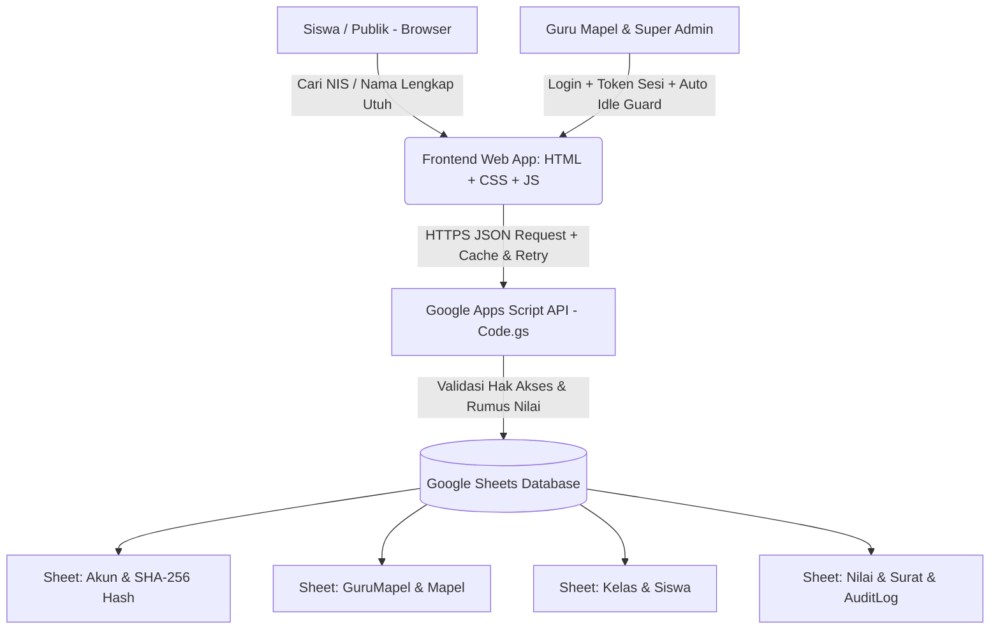
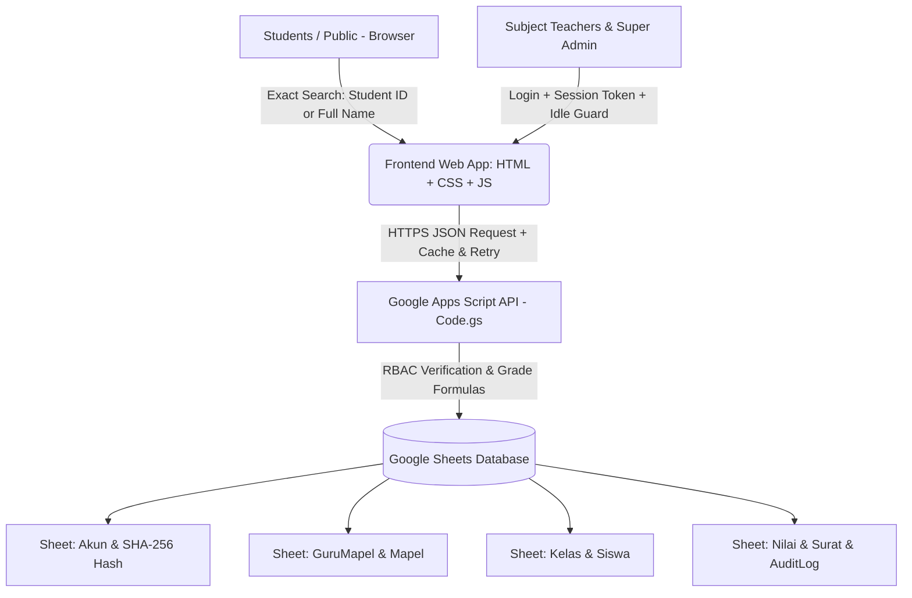

<div align="center">

<!-- HERO HEADER & LOGO -->


<h1>Portal Hasil Penilaian</h1>
<p><strong>Sistem Transparansi Nilai Akademik Modern • Gratis & Open-Source</strong></p>

<p>
  <a href="#-bahasa-indonesia-utama"><kbd>🇮🇩 BAHASA INDONESIA (UTAMA)</kbd></a>
  &nbsp;&nbsp;•&nbsp;&nbsp;
  <a href="#-english-version-secondary"><kbd>🇬🇧 ENGLISH VERSION (SECONDARY)</kbd></a>
</p>

<p>
  
  
  
  
</p>

<p>
  <strong>Dirancang & Dikembangkan oleh:</strong><br/>
  <h3>👨‍💻 Ilham Muhammad Furqon, S.Kom.</h3>
</p>

</div>

---

<!-- ===================================================================== -->
<!--                    BAGIAN 1: BAHASA INDONESIA (UTAMA)                 -->
<!-- ===================================================================== -->

<div id="-bahasa-indonesia-utama"></div>

# 🇮🇩 Dokumentasi Utama (Bahasa Indonesia)

> **Navigasi Cepat (Klik untuk melompat ke bagian tujuan):**
>
> <a href="#id-1-kenapa-ini-dibuat"><kbd>1. Kenapa Ini Dibuat?</kbd></a> &nbsp;
> <a href="#id-2-deskripsi-aplikasi"><kbd>2. Deskripsi & Fitur</kbd></a> &nbsp;
> <a href="#id-3-cara-install-pasang-dan-penggunaan"><kbd>3. Instalasi, Pemasangan & Penggunaan</kbd></a> &nbsp;
> <a href="#id-4-kenapa-ini-open-source"><kbd>4. Kenapa Open-Source?</kbd></a> &nbsp;
> <a href="#id-5-dukungan--donasi"><kbd>5. Donasi & QR Code</kbd></a> &nbsp;
> <a href="#id-6-tentang-pembuat"><kbd>6. Tentang Pembuat</kbd></a>

---

<div id="id-1-kenapa-ini-dibuat"></div>

## 1. 💡 Kenapa Ini Dibuat?

Dalam proses evaluasi pembelajaran di sekolah, penyampaian hasil nilai ulangan, tugas proyek, maupun ujian sering kali menghadapi berbagai kendala teknis dan psikologis di lapangan. **Portal Hasil Penilaian** lahir dari kebutuhan nyata untuk memecahkan masalah-masalah berikut:

| Permasalahan di Lapangan | Solusi yang Dihadirkannya |
| :--- | :--- |
| **1. Kecemasan & Ketidakpastian Siswa**<br/>Siswa sering kali harus menunggu lama atau bertanya berulang-ulang kepada guru hanya untuk mengetahui apakah nilainya sudah tuntas (KKM) atau harus mengikuti remedial. | **Akses Mandiri & Transparan 24/7**<br/>Siswa cukup mengetik **NIS** atau **Nama Lengkap** secara utuh untuk langsung melihat rincian nilai per mata pelajaran beserta status ketuntasannya secara *real-time*. |
| **2. Beban Administrasi Guru yang Berulang**<br/>Guru harus merekap nilai secara manual, menjawab pesan masuk satu per satu dari puluhan siswa, serta membuat format rekapitulasi yang berbeda-beda. | **Otomatisasi Rumus, Excel & Template WA**<br/>Perhitungan nilai akhir, pembagian poin tambahan (*overflow*), impor/ekspor template Excel, hingga format pesan WhatsApp remedial yang sopan tersedia otomatis dalam satu klik. |
| **3. Biaya Sewa Server & Domain yang Mahal**<br/>Banyak sekolah atau guru secara individu kesulitan membangun sistem portal nilai karena keterbatasan anggaran sewa VPS, *cloud hosting*, maupun *database* berbayar. | **Infrastruktur 100% Gratis (Serverless)**<br/>Memanfaatkan **Google Sheets** sebagai *database* dan **Google Apps Script** sebagai API *backend*, dipadukan dengan *frontend* statis ringan yang dapat di-*hosting* gratis selamanya. |
| **4. Miskomunikasi Saat Pengajuan Remedial**<br/>Siswa sering menghubungi guru lewat WhatsApp tanpa mencantumkan identitas lengkap (nama, kelas, maupun mata pelajaran yang dimaksud). | **Template Pesan Remedial Terstruktur**<br/>Jika nilai berada di bawah KKM, kartu hasil otomatis menampilkan panduan dan tombol salin pesan WhatsApp sopan yang sudah terisi identitas siswa secara otomatis. |

---

<div id="id-2-deskripsi-aplikasi"></div>

## 2. 🚀 Deskripsi Aplikasi & Arsitektur Sistem

**Portal Hasil Penilaian** adalah aplikasi web modern berbasis arsitektur terpisah (*decoupled frontend & serverless backend*) yang dirancang khusus untuk mengelola, menghitung, mempublikasikan, dan memantau hasil evaluasi belajar siswa (seperti jenjang Kelas VII, VIII, XI, maupun ujian khusus seperti TKA dan Ujian Praktik).

### 🏗️ Diagram Alur Arsitektur Sistem



### ✨ Fitur Utama (Klik untuk Membuka Rincian)

<details open>
<summary><strong>🎓 A. Portal Siswa & Publik (Tanpa Login)</strong></summary>

1. **Pencarian Presisi Tinggi**: Siswa wajib memasukkan **NIS** atau **Nama Lengkap** secara utuh (mencegah kebocoran daftar seluruh siswa secara acak), kemudian memilih mata pelajaran atau jenis ujian yang ingin dilihat.
2. **4 Variasi Tampilan Kartu Hasil Nilai**:
   - **Default Card**: Menampilkan komponen lengkap (Nilai 1 / Slide 1, Nilai 2 / Slide 2, Nilai 3 / Presentasi, Nilai Tambah, dan Nilai Akhir).
   - **Nilai Akhir Saja**: Tampilan ringkas yang menonjolkan skor akhir dan poin tambahan.
   - **Kartu Khusus TKA (Tes Kemampuan Akademik)**: Dirancang khusus untuk menampilkan sub-nilai literasi/numerasi (seperti TKA Bahasa Indonesia, Matematika, Bahasa Inggris, dll).
   - **Kartu Kustom (Input Sendiri)**: Menampilkan label komponen penilaian yang disesuaikan langsung oleh Admin.
3. **Notifikasi Status & Audio Interaktif**:
   - **Status AMAN (≥ KKM)**: Efek suara apresiasi positif dan lencana hijau kelulusan.
   - **Status REMEDIAL (< KKM)**: Efek suara peringatan lembut, penjelasan instruksi remedial, serta tombol **Salin Pesan WhatsApp Siap Kirim** yang sopan dan terisi otomatis.
4. **Papan Peringkat Apresiasi (Auto-Rotate 30 Detik)**:
   - Menampilkan 6 kategori nilai terbaik (Pembuatan Slide, Presentasi, dan Total Akhir baik per Kelompok maupun per Individu) yang berganti otomatis setiap 30 detik dan dapat difilter berdasarkan Kelas maupun Mata Pelajaran.
5. **Tema Otomatis Siang/Malam**: Menyesuaikan mode *Light* (06:00–17:59) dan *Dark* (18:00–05:59) secara *real-time* sesuai jam lokal perangkat.

</details>

<details>
<summary><strong>🔐 B. Panel Administrator & Keamanan Berlapis</strong></summary>

1. **Pemisahan Hak Akses (Role-Based Access Control)**:
   - **Admin Pertama (Super Admin)**: Mengelola seluruh data master (*Master Guru Mapel, Master Mapel/Ujian, Master Kelas, Master Siswa, Master Akun, Kotak Surat Koreksi,* dan *Log Keamanan*).
   - **Guru Mata Pelajaran (Admin Lainnya)**: Saat pertama kali masuk, wajib memilih kelas yang diampu. Mata pelajaran pada form input nilai otomatis dikunci berdasarkan data pada *Master Akun* sehingga tidak dapat diubah atau disalahgunakan.
2. **Keamanan Password & Sesi**:
   - Password disimpan menggunakan *hashing* satu arah **SHA-256 + Salt** di server Google Apps Script. Password asli maupun *hash* **tidak pernah dikirim** ke antarmuka web.
   - Dilengkapi **Peringatan Tidak Aktif (Idle Warning Tahap 1, 2, dan 3)** dengan sinyal audio dan *auto-logout* demi mencegah penyalahgunaan komputer bersama.
3. **Rumus Nilai Akhir & Distribusi Poin Tambah Otomatis**:
   - Jika `Nilai Akhir + Nilai Tambah` melebihi `100`, sistem otomatis menahan Nilai Akhir di angka `100` dan mendistribusikan kelebihan poin ke komponen `Nilai 1`, `Nilai 2`, atau `Nilai 3` secara adil hingga maksimal `100`.
4. **Integrasi Excel & Surat Koreksi Data Siswa**:
   - Unduh template Excel sesuai kelas ampuan, isi atau perbarui nilai secara massal di Excel, lalu unggah kembali.
   - Fitur **Surat Permohonan Koreksi Data Siswa** untuk melaporkan kesalahan penulisan NIS atau Nama siswa langsung ke kotak masuk Admin Pertama (dapat dicetak/disimpan sebagai PDF).

</details>

---

<div id="id-3-cara-install-pasang-dan-penggunaan"></div>

## 3. 🛠️ Cara Install, Pasang, dan Penggunaan

Ikuti panduan langkah demi langkah di bawah ini untuk memasang aplikasi dari awal hingga siap digunakan oleh siswa dan guru.

<details open>
<summary><strong>Langkah 1: Menyiapkan Database Google Sheets & Backend Apps Script</strong></summary>

1. Buka [Google Drive](https://drive.google.com), klik **Baru (+)** ➔ **Google Spreadsheet**, lalu beri nama misalnya `Database Portal Hasil Penilaian`.
2. Pada menu atas Spreadsheet, klik **Ekstensi (Extensions)** ➔ **Apps Script**.
3. Hapus seluruh kode bawaan di file `Code.gs`, lalu salin dan tempel seluruh kode dari file **`backend/Code.gs`**.
4. Klik ikon **Simpan (💾)**, kemudian pada bilah atas pilih fungsi **`setupDatabase`** dan klik **Jalankan (Run)**.
   - *Catatan*: Saat pertama kali dijalankan, Google akan meminta izin akses. Klik **Review Permissions** ➔ pilih akun Google Anda ➔ klik **Advanced** ➔ **Go to ... (unsafe)** ➔ **Allow**.
   - Fungsi ini otomatis membuat 8 lembar kerja (*Akun, GuruMapel, Mapel, Kelas, Siswa, Nilai, Surat, AuditLog*) beserta akun bawaan Super Admin:
     - **Username**: `admin`
     - **Password**: `admin123` *(segera ubah setelah berhasil masuk!)*
5. Klik tombol **Terapkan (Deploy)** di pojok kanan atas ➔ **Deployment baru (New deployment)**.
6. Pada bagian *Pilih jenis (Select type)*, klik ikon roda gigi ➔ pilih **Aplikasi web (Web app)**:
   - **Deskripsi**: `API Portal Hasil Penilaian v3`
   - **Jalankan sebagai (Execute as)**: `Saya (Me)`
   - **Yang memiliki akses (Who has access)**: `Siapa saja (Anyone)`
7. Klik **Terapkan (Deploy)**, lalu salin **URL Aplikasi Web (`https://script.google.com/macros/s/.../exec`)**.

</details>

<details>
<summary><strong>Langkah 2: Menghubungkan Frontend & Memasang (Hosting Gratis)</strong></summary>

1. Pastikan struktur folder proyek Anda tersusun lengkap seperti berikut:
   ```text
   portal-penilaian/
   ├── index.html
   ├── Logo.png
   ├── README.md
   ├── css/
   │   └── style.css
   └── js/
       ├── config.js
       ├── theme-audio.js
       ├── api.js
       ├── ui-components.js
       ├── guest.js
       ├── security.js
       ├── excel-letter.js
       └── admin.js
   ```
2. Buka file **`js/config.js`** dan tempel URL Web App dari Langkah 1 ke parameter `API_URL`:
   ```javascript
   const APP_CONFIG = {
     API_URL: '[https://script.google.com/macros/s/PASTE_URL_WEB_APP_ANDA_DISINI/exec](https://script.google.com/macros/s/PASTE_URL_WEB_APP_ANDA_DISINI/exec)',
     KKM: 75,
     LEADERBOARD_INTERVAL_MS: 30000,
     IDLE_WARN_1_MS: 180000,
     IDLE_WARN_2_MS: 300000,
     IDLE_WARN_3_MS: 420000,
     IDLE_LOGOUT_MS: 480000
   };
   ```
3. **Cara Memasang Online (Pilih Salah Satu — Gratis)**:
   - **GitHub Pages**: Unggah seluruh folder ke repositori GitHub ➔ buka **Settings** ➔ **Pages** ➔ pilih branch `main` dan folder `/ (root)` ➔ klik **Save**.
   - **Vercel / Netlify**: Seret dan lepas (*drag & drop*) folder `portal-penilaian` ke dasbor [Netlify Drop](https://app.netlify.com/drop) atau hubungkan repositori ke [Vercel](https://vercel.com).
   - **Penggunaan Lokal**: Buka file `index.html` langsung di peramban modern (Chrome, Edge, Firefox, Safari).

</details>

<details>
<summary><strong>Langkah 3: Panduan Penggunaan (Super Admin, Guru Mapel, & Siswa)</strong></summary>

- **Bagi Admin Pertama (Super Admin)**:
  1. Klik **Login Admin** di pojok kanan atas dan masuk menggunakan akun awal (`admin` / `admin123`), lalu segera ganti password pada tab **Master Akun**.
  2. Isi data secara berurutan: **Master Guru Mapel** (opsional) ➔ **Master Mapel / Ujian** (atur nama mapel/ujian dan pilih bentuk *card* hasil) ➔ **Master Kelas** ➔ **Master Siswa** ➔ **Master Akun** (buat akun untuk masing-masing guru mapel).
- **Bagi Guru Mata Pelajaran**:
  1. Masuk menggunakan username dan password yang diberikan oleh Admin Pertama.
  2. Pada jendela *pop-up* pertama, centang kelas-kelas yang Anda ampu lalu klik **Simpan Kelas Ampuan**.
  3. Masuk ke tab **Master Input Nilai**, klik **+ Input Nilai** (cari nama/NIS siswa, mata pelajaran otomatis terisi sesuai akun Anda), atau gunakan **Download Template Excel** ➔ isi/edit di Excel ➔ **Upload Excel Nilai**.
- **Bagi Siswa**:
  1. Buka halaman utama portal tanpa perlu login.
  2. Ketik **NIS** atau **Nama Lengkap** secara utuh pada kolom pencarian dan klik **Cari Nilai**.
  3. Pilih tab **Mata Pelajaran / Ujian** yang tersedia untuk melihat rincian nilai atau menyalin pesan template WhatsApp jika berstatus Remedial.

</details>

---

<div id="id-4-kenapa-ini-open-source"></div>

## 4. 🌍 Kenapa Ini Open-Source?

Proyek **Portal Hasil Penilaian** dirilis secara terbuka (*open-source*) di bawah lisensi **MIT** atas dasar keyakinan bahwa teknologi pendidikan yang berkualitas harus dapat diakses oleh setiap sekolah, madrasah, maupun pendidik tanpa hambatan biaya lisensi:

1. **Pemerataan Akses Digital Sekolah**: Tidak semua institusi pendidikan memiliki anggaran pengadaan perangkat lunak mahal. Dengan sifat *open-source* dan berbasis Google Sheets, sekolah mana pun dapat langsung memakainya secara gratis.
2. **Transparansi & Keamanan Data**: Setiap pengelola TI sekolah atau pengembang dapat memeriksa langsung baris demi baris kode sumbernya untuk memastikan tidak ada pencurian data siswa maupun skrip tersembunyi.
3. **Kebebasan Kustomisasi**: Setiap sekolah memiliki aturan penilaian unik (misalnya KKM berbeda, format TKA, ujian praktik, atau penilaian proyek). Kode sumber terbuka memudahkan siapa saja menyesuaikan sistem sesuai kebutuhan masing-masing.
4. **Kolaborasi Berkelanjutan**: Terbuka bagi sesama pengembang, guru TIK, dan praktisi pendidikan untuk ikut menyempurnakan fitur di masa mendatang.

---

<div id="id-5-dukungan--donasi"></div>

## 5. ❤️ Dukungan & Donasi (Agar Proyek Tetap Gratis)

Aplikasi ini dikembangkan dan dipelihara secara mandiri agar tetap **100% gratis** bagi para guru, siswa, dan sekolah di seluruh Indonesia. Jika aplikasi ini membantu meringankan pekerjaan administrasi Anda dan Anda ingin mendukung pengembangan fitur-fitur berikutnya, Anda dapat memberikan dukungan sukarela melalui saluran berikut:

<table>
  <tr>
    <td align="center" width="260">
      <strong>📱 Scan QR Code (Nomor BRI)</strong><br/><br/>
      <br/>
      <sub>Kode QR Nomor Rekening BRI:<br/><code>427401025594536</code></sub>
    </td>
    <td valign="top">
      <h3>💳 Transfer Bank & E-Wallet</h3>
      <p>Seluruh dukungan digunakan untuk riset, pemeliharaan dokumentasi, serta pengembangan aplikasi pendidikan gratis lainnya.</p>
      <table>
        <thead>
          <tr>
            <th>Metode Pembayaran</th>
            <th>Nomor Rekening / Tujuan</th>
            <th>Atas Nama</th>
          </tr>
        </thead>
        <tbody>
          <tr>
            <td><strong>🏦 Bank BRI</strong></td>
            <td><code>427401025594536</code></td>
            <td><strong>Ilham Muhammad Furqon, S.Kom.</strong></td>
          </tr>
          <tr>
            <td><strong>🧡 ShopeePay</strong></td>
            <td><code>081807982673</code></td>
            <td><strong>Ilham Muhammad Furqon, S.Kom.</strong></td>
          </tr>
        </tbody>
      </table>
      <p><em>Terima kasih atas kebaikan hati dan dukungan Anda untuk kemajuan teknologi pendidikan Indonesia! 🙏</em></p>
    </td>
  </tr>
</table>

---

<div id="id-6-tentang-pembuat"></div>

## 6. 👨‍💻 Tentang Pembuat

<table>
  <tr>
    <td>
      <h3>Ilham Muhammad Furqon, S.Kom.</h3>
      <p><strong>Pengembang Perangkat Lunak & Pemerhati Teknologi Pendidikan</strong></p>
      <p>
        <strong>Ilham Muhammad Furqon, S.Kom.</strong> adalah lulusan Sarjana Komputer (S.Kom.) yang berfokus pada pengembangan solusi sistem informasi yang ringan, aman, dan berdampak langsung bagi dunia pendidikan. Melalui <strong>Portal Hasil Penilaian</strong>, beliau berkomitmen menghadirkan jembatan komunikasi akademik yang transparan antara guru dan siswa tanpa membebani sekolah dengan biaya infrastruktur yang tinggi.
      </p>
    </td>
  </tr>
</table>

---
---

<!-- ===================================================================== -->
<!--               SECTION 2: ENGLISH VERSION (SECONDARY)                  -->
<!-- ===================================================================== -->

<div id="-english-version-secondary"></div>

# 🇬🇧 Secondary Documentation (English Version)

> **Quick Navigation (Click to jump to any section):**
>
> <a href="#en-1-why-was-this-built"><kbd>1. Why Was This Built?</kbd></a> &nbsp;
> <a href="#en-2-project-description"><kbd>2. Description & Features</kbd></a> &nbsp;
> <a href="#en-3-installation-deployment-and-usage"><kbd>3. Installation, Setup & Usage</kbd></a> &nbsp;
> <a href="#en-4-why-is-this-open-source"><kbd>4. Why Open-Source?</kbd></a> &nbsp;
> <a href="#en-5-support--donation"><kbd>5. Donation & QR Code</kbd></a> &nbsp;
> <a href="#en-6-about-the-creator"><kbd>6. About the Creator</kbd></a>

---

<div id="en-1-why-was-this-built"></div>

## 1. 💡 Why Was This Built?

During school academic evaluations, publishing exam scores, project grades, and remedial notices often encounters real-world technical and administrative bottlenecks. **Portal Hasil Penilaian** (*Academic Assessment Result Portal*) was created to solve four core challenges:

| Real-World Challenge | How This System Solves It |
| :--- | :--- |
| **1. Student Anxiety & Grade Uncertainty**<br/>Students frequently wait days or repeatedly message teachers just to find out whether they passed the minimum passing grade (KKM) or need remedial work. | **24/7 Self-Service & Transparent Access**<br/>Students simply enter their full **Student ID (NIS)** or **Full Name** to immediately inspect their subject scores and passing status in real time. |
| **2. Repetitive Teacher Administrative Workload**<br/>Teachers spend hours manually calculating final scores, answering individual inquiries, and formatting spreadsheets. | **Automated Formulas, Excel Sync & WA Templates**<br/>Final score calculations, extra-point overflow distribution, Excel template import/export, and polite remedial WhatsApp templates work automatically. |
| **3. Expensive Server & Database Hosting Costs**<br/>Many schools and individual educators lack dedicated budgets for VPS servers, paid cloud databases, or proprietary LMS licenses. | **100% Free Serverless Infrastructure**<br/>Powered by **Google Sheets** as the database and **Google Apps Script** as the backend API, paired with a lightweight static frontend hostable for free anywhere. |
| **4. Unstructured Remedial Messages**<br/>Students often message teachers on WhatsApp without stating their full name, class, or the specific subject they are asking about. | **Auto-Filled Remedial WhatsApp Template**<br/>Whenever a student scores below the passing threshold, the result card provides clear instructions and a one-click copyable WhatsApp message pre-filled with their details. |

---

<div id="en-2-project-description"></div>

## 2. 🚀 Project Description & System Architecture

**Portal Hasil Penilaian** is a modern web application built on a decoupled frontend and serverless backend architecture designed to manage, calculate, publish, and analyze student assessment outcomes (including junior/senior high school classes as well as specialized assessments such as Academic Aptitude Tests / TKA and Practical Exams).

### 🏗️ System Architecture Flowchart



### ✨ Core Features (Click to Expand Details)

<details open>
<summary><strong>🎓 A. Public Student Portal (No Login Required)</strong></summary>

1. **Exact-Match Search Privacy**: Students must enter their complete **NIS (Student ID)** or **Full Name** (preventing unauthorized browsing of the entire student directory), then select the desired subject or exam tab.
2. **4 Dynamic Result Card Layouts**:
   - **Default Card**: Displays complete assessment components (Score 1 / Slide 1, Score 2 / Slide 2, Score 3 / Presentation, Bonus Points, and Final Score).
   - **Final Score Only Card**: A clean, streamlined card highlighting the final grade and bonus points.
   - **TKA Card (Academic Aptitude Test)**: Tailored for specialized sub-scores such as Indonesian Literacy, Mathematics Numeracy, and English Reasoning.
   - **Custom Card**: Displays custom component labels defined directly by the Administrator.
3. **Status Feedback & Interactive Web Audio**:
   - **SAFE / PASSED (≥ KKM)**: Synthesized celebratory chime and green completion badge.
   - **REMEDIAL (< KKM)**: Gentle alert tone, remedial instructions, and a one-click copyable **WhatsApp Message Template** pre-filled with the student's identity.
4. **Auto-Rotating Leaderboard (30-Second Interval)**:
   - Highlights top performers across 6 categories (Slide Creation, Presentation, and Final Total for both Groups and Individuals), rotating every 30 seconds with Class and Subject filters.
5. **Real-Time Auto Light/Dark Theme**: Automatically switches between Light mode (06:00–17:59) and Dark mode (18:00–05:59) based on local device time.

</details>

<details>
<summary><strong>🔐 B. Administrator Panel & Multi-Layer Security</strong></summary>

1. **Role-Based Access Control (RBAC)**:
   - **First Admin (Super Admin)**: Full control over all master records (*Teachers, Subjects/Exams, Classes, Students, Accounts, Correction Inbox,* and *Security Audit Logs*).
   - **Subject Teachers (Secondary Admins)**: On first login, teachers select the classes they teach. The subject field during grade entry is automatically locked to their assigned subject from the Account Master.
2. **Password & Session Security**:
   - Passwords are secured with one-way **SHA-256 + Salt** hashing on Google Apps Script. Plaintext passwords and hashes are **never transmitted** to the frontend UI.
   - Includes **3-Stage Inactivity Warnings (Warning 1, 2, and 3)** with audio alerts and automatic logout to protect shared school computers.
3. **Automated Grade & Overflow Distribution Formula**:
   - When `Final Score + Bonus Points` exceeds `100`, the system caps the Final Score at `100` and evenly distributes overflow points across `Score 1`, `Score 2`, and `Score 3` (up to `100` each).
4. **Excel Integration & Student Data Correction Letters**:
   - Download pre-formatted Excel templates scoped to assigned classes, enter or edit scores offline, and upload them back in bulk.
   - Built-in **Correction Letter System** allowing teachers to flag Student ID or Name typos directly to the Super Admin's inbox (with print/PDF support).

</details>

---

<div id="en-3-installation-deployment-and-usage"></div>

## 3. 🛠️ Installation, Deployment, and Usage Guide

Follow the step-by-step instructions below to set up and deploy the portal from scratch.

<details open>
<summary><strong>Step 1: Set Up Google Sheets Database & Apps Script Backend</strong></summary>

1. Open [Google Drive](https://drive.google.com), click **New (+)** ➔ **Google Sheets**, and name it `Portal Hasil Penilaian Database`.
2. In the top menu bar, navigate to **Extensions** ➔ **Apps Script**.
3. Delete any default code in `Code.gs`, then paste the entire code from **`backend/Code.gs`**.
4. Click **Save (💾)**, select the **`setupDatabase`** function from the top toolbar dropdown, and click **Run**.
   - *Note*: Grant the required permissions when prompted (**Review Permissions** ➔ choose your Google account ➔ **Advanced** ➔ **Go to ... (unsafe)** ➔ **Allow**).
   - This automatically creates all 8 database sheets (*Akun, GuruMapel, Mapel, Kelas, Siswa, Nilai, Surat, AuditLog*) along with the default Super Admin account:
     - **Username**: `admin`
     - **Password**: `admin123` *(change this immediately after logging in!)*
5. Click **Deploy** in the top-right corner ➔ **New deployment**.
6. Click the gear icon next to *Select type* ➔ choose **Web app**:
   - **Description**: `Portal Hasil Penilaian API v3`
   - **Execute as**: `Me`
   - **Who has access**: `Anyone`
7. Click **Deploy** and copy the generated **Web App URL (`https://script.google.com/macros/s/.../exec`)**.

</details>

<details>
<summary><strong>Step 2: Connect Frontend & Host for Free</strong></summary>

1. Ensure your project directory matches the following structure:
   ```text
   portal-penilaian/
   ├── index.html
   ├── Logo.png
   ├── README.md
   ├── css/
   │   └── style.css
   └── js/
       ├── config.js
       ├── theme-audio.js
       ├── api.js
       ├── ui-components.js
       ├── guest.js
       ├── security.js
       ├── excel-letter.js
       └── admin.js
   ```
2. Open **`js/config.js`** and paste your Web App URL from Step 1 into `API_URL`:
   ```javascript
   const APP_CONFIG = {
     API_URL: '[https://script.google.com/macros/s/PASTE_YOUR_WEB_APP_URL_HERE/exec](https://script.google.com/macros/s/PASTE_YOUR_WEB_APP_URL_HERE/exec)',
     KKM: 75,
     LEADERBOARD_INTERVAL_MS: 30000,
     IDLE_WARN_1_MS: 180000,
     IDLE_WARN_2_MS: 300000,
     IDLE_WARN_3_MS: 420000,
     IDLE_LOGOUT_MS: 480000
   };
   ```
3. **Free Hosting Options**:
   - **GitHub Pages**: Push the project folder to a GitHub repository ➔ go to **Settings** ➔ **Pages** ➔ select `main` branch and `/ (root)` folder ➔ click **Save**.
   - **Netlify / Vercel**: Drag and drop the `portal-penilaian` folder onto [Netlify Drop](https://app.netlify.com/drop) or import the repository into [Vercel](https://vercel.com).
   - **Local Execution**: Open `index.html` directly in any modern web browser.

</details>

<details>
<summary><strong>Step 3: User Manual (Super Admin, Teachers, & Students)</strong></summary>

- **For the First Admin (Super Admin)**:
  1. Click **Login Admin** at the top right, log in with `admin` / `admin123`, and update your password under **Master Akun**.
  2. Populate master records in order: **Master Guru Mapel** (optional) ➔ **Master Mapel / Ujian** (configure subjects and select the result card layout) ➔ **Master Kelas** ➔ **Master Siswa** ➔ **Master Akun** (create accounts for subject teachers).
- **For Subject Teachers**:
  1. Log in using the credentials issued by the Super Admin.
  2. On the initial prompt, check the classes you teach and click **Simpan Kelas Ampuan**.
  3. Open **Master Input Nilai**, click **+ Input Nilai** (search by Student ID or Name; your subject is locked automatically), or use **Download Template Excel** ➔ fill/edit grades in Excel ➔ **Upload Excel Nilai**.
- **For Students**:
  1. Visit the public portal without logging in.
  2. Type your complete **Student ID (NIS)** or **Full Name** in the search box and click **Cari Nilai**.
  3. Switch between **Subject / Exam** tabs to view your grade breakdown or copy the pre-filled WhatsApp remedial message if needed.

</details>

---

<div id="en-4-why-is-this-open-source"></div>

## 4. 🌍 Why Is This Open-Source?

**Portal Hasil Penilaian** is released as free and **open-source software** under the **MIT License** based on the principle that reliable educational technology should be accessible to every school and teacher without financial barriers:

1. **Equal Digital Access for Schools**: Not every school has the budget for expensive proprietary software. By combining open-source code with free Google Sheets infrastructure, any school can deploy it immediately at zero cost.
2. **Full Data Transparency & Security**: School IT administrators and developers can inspect every line of code to verify how student data is handled, ensuring complete privacy and trust.
3. **Freedom to Customize**: Every institution has unique grading rules (custom KKM thresholds, TKA aptitude assessments, practical exams, or project rubrics). Open-source access empowers schools to tailor the platform to their exact curriculum.
4. **Community Collaboration**: Fellow developers, ICT teachers, and ed-tech enthusiasts are welcome to contribute enhancements and share improvements openly.

---

<div id="en-5-support--donation"></div>

## 5. ❤️ Support & Donation (Keep This Project Free)

This software is independently built and maintained so that it remains **100% free** for teachers, students, and schools everywhere. If this portal saves you time and you would like to support ongoing maintenance and new open-source educational tools, voluntary contributions are warmly appreciated via the channels below:

<table>
  <tr>
    <td align="center" width="260">
      <strong>📱 Scan QR Code (BRI Account)</strong><br/><br/>
      <br/>
      <sub>QR Code for Bank BRI Account:<br/><code>427401025594536</code></sub>
    </td>
    <td valign="top">
      <h3>💳 Bank Transfer & E-Wallet</h3>
      <p>Every contribution goes directly toward research, documentation, and building more free open-source tools for educators.</p>
      <table>
        <thead>
          <tr>
            <th>Payment Method</th>
            <th>Account / Phone Number</th>
            <th>Account Holder</th>
          </tr>
        </thead>
        <tbody>
          <tr>
            <td><strong>🏦 Bank BRI</strong></td>
            <td><code>427401025594536</code></td>
            <td><strong>Ilham Muhammad Furqon, S.Kom.</strong></td>
          </tr>
          <tr>
            <td><strong>🧡 ShopeePay</strong></td>
            <td><code>081807982673</code></td>
            <td><strong>Ilham Muhammad Furqon, S.Kom.</strong></td>
          </tr>
        </tbody>
      </table>
      <p><em>Thank you for your generosity and support in advancing open-source educational technology! 🙏</em></p>
    </td>
  </tr>
</table>

---

<div id="en-6-about-the-creator"></div>

## 6. 👨‍💻 About the Creator

<table>
  <tr>
    <td>
      <h3>Ilham Muhammad Furqon, S.Kom.</h3>
      <p><strong>Software Developer & Educational Technology Advocate</strong></p>
      <p>
        <strong>Ilham Muhammad Furqon, S.Kom.</strong> holds a Bachelor of Computer Science (S.Kom.) degree and specializes in crafting lightweight, secure, and practical information systems for schools and educators. Through <strong>Portal Hasil Penilaian</strong>, he aims to bridge academic transparency between teachers and students without requiring costly server infrastructure.
      </p>
    </td>
  </tr>
</table>

---

<div align="center">
  <sub>© 2026 <strong>Ilham Muhammad Furqon, S.Kom.</strong> — Released under the MIT Open-Source License.</sub>
</div>
